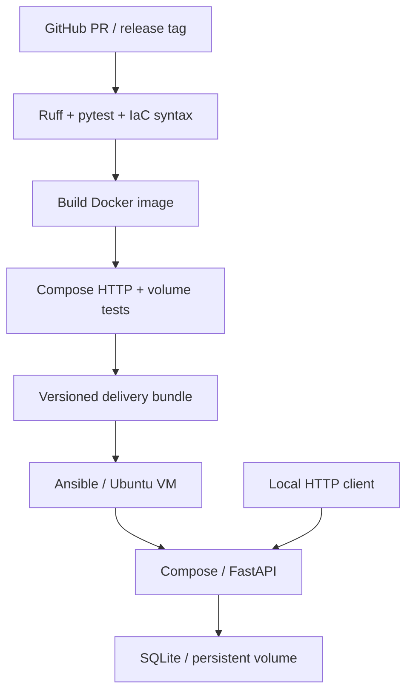

# Architecture and decisions

CI validates pushes and pull requests; its explicit steps preserve Love's CI contribution.
The release workflow runs the equivalent checks through `scripts/checks.sh`.
PRs stop after verification. Release tags additionally package the same tested image and
publish it. The bundle is applied by Ansible; a CI runner is only a disposable test host.
Failed checks stop delivery. Deployment checks `/health` and requires the expected version.

| Component | Purpose and interaction | Decision / trade-off |
|---|---|---|
| FastAPI + Pydantic | Routes validate create/update requests and return typed JSON | Small scope, generated interactive documentation; no separate UI |
| SQLite | Synchronous handlers use short transactions and bound SQL parameters | No separate database service; single instance and limited write concurrency |
| pytest | API validation, state changes, DB faults and real-process restart | Each test has isolated temporary storage; Docker persistence is separately tested |
| Ruff | Enforced static analysis and formatting in the gate | Satisfies quality automation; not a security audit or dependency-vulnerability scan |
| Docker | Runtime and locked packages in one non-root image | Versioned Python base tag; digest pinning remains a reproducibility improvement |
| Compose | Same service, loopback port, storage and security options in test/deployment | Named volume survives recreation; security options limit runtime writes |
| Actions | Checks PRs/pushes and independently gates version-tag delivery | SHA-pinned actions and least-permission jobs; private Actions quota is account-dependent |
| Release archives | Deliver the tested image, exact ID and deployment configuration | No registry/cloud dependency; manual VM application, larger downloadable asset |
| Ansible | Installs Ubuntu container packages and applies the delivered image | Built-in modules, no collection dependency; OS/architecture intentionally restricted |

Schema version 1 supports current application behaviour. Startup refuses a database with an
unknown newer schema. No migration system is included. Application rollback changes the image
and preserves the volume; restoring data requires a separate backup procedure.

The container runs as UID/GID 10001. Docker initialises a new named volume from the image's
owned `/data` directory. The root filesystem is read-only and all Linux capabilities are
dropped. HTTP binds to loopback because the application has no authentication or TLS.
Host administrators/Ansible use sudo for Docker; users are not added to the privileged Docker group.

Runtime dependencies and tool versions are locked with SHA256 package hashes. The dev lock
is constrained by the runtime lock, so CI tests the same runtime package versions. Python
and action revisions are pinned. Ubuntu package installation tracks supported updates;
this is reproducible configuration, not a byte-identical or indefinitely frozen host.

Primary references:

- [FastAPI lifespan](https://fastapi.tiangolo.com/advanced/events/)
- [Docker Compose](https://docs.docker.com/compose/)
- [Ubuntu 24.04 Compose package](https://packages.ubuntu.com/noble/docker-compose-v2)
- [Ansible apt module](https://docs.ansible.com/projects/ansible/latest/collections/ansible/builtin/apt_module.html)
- [GitHub workflow triggering](https://docs.github.com/en/actions/how-tos/write-workflows/choose-when-workflows-run/trigger-a-workflow)
